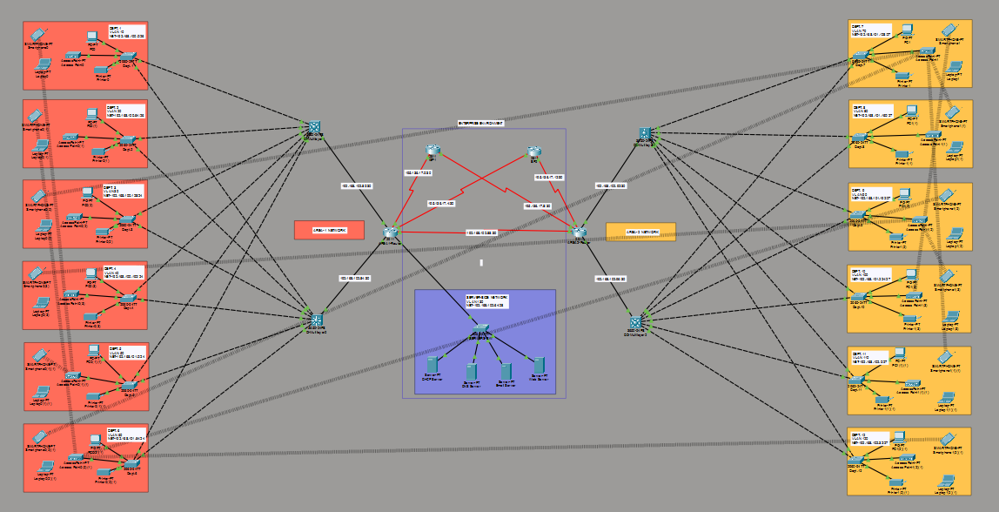

# 🏥 Hospital Network Infrastructure — Cisco Packet Tracer

Design and implementation of a hierarchical, segmented and redundant network
for a hospital environment with a main site (HQ) and a branch office (Branch).



> **Lab note:** all passwords in this repository (`cisco`) are **lab-only** values
> used in a simulated Packet Tracer environment. No real infrastructure is exposed.

## 🛠️ Skills demonstrated

VLANs & 802.1Q trunking · Inter-VLAN routing (SVIs / router-on-a-stick) · Layer 3 switching ·
OSPF · Floating static routes (ISP failover) · Subnetting / VLSM · DHCP & DHCP Relay ·
SSH hardening · Port Security · Network documentation & troubleshooting

## 🗺️ Topology

- **HQ**: 1 Core Router + 2 Multilayer Switches + L2 access switches
- **Branch**: 1 Router + 2 Multilayer Switches + L2 access switches
- **WAN**: HQ↔Branch serial link + 2 ISPs (redundancy)
- **VLANs**: 12 departments (VLAN 10–120)

## Design principles and constraints

- **Cost-effectiveness**: hierarchical design with minimal provisioning, while guaranteeing redundancy.
- **Security (CIA triad)**: Confidentiality, Integrity and Availability through segmentation, ACLs and encryption.
- **Segmentation**: each department lives in its own **VLAN** and its own **subnet**.
- **Hierarchical & redundant model**: each site has **one Core Router**, **two Multilayer (L3) Switches** and several **L2 Access Switches**. HQ and Branch routers are connected by a **serial link**, and each connects to **two separate ISPs** for WAN redundancy.
- **Wireless**: every department must have wireless access for its users.

---

## IP addressing plan and subnetting

- **Base private network**: `192.168.100.0` (subnetted to fit all departments).
- **User estimate**: HQ departments ≈ 60 users each; Branch departments ≈ 30 users each → `/26` for HQ, `/27` for Branch.
- **Public IPs (WAN/Internet)**:
  - `195.136.17.0/30`
  - `195.136.17.4/30`
  - `195.136.17.8/30`
  - `195.136.17.12/30`
- **Server room**: static IPs. All end-user devices get IPs **dynamically** from the dedicated DHCP servers.

Full table: [docs/addressing.md](docs/addressing.md)

---

## Implementation status

| # | Task | Status |
|---|------|--------|
| 1 | Network design and layout in Packet Tracer | ✅ Done |
| 2 | Base device config (hostnames, passwords, banners, no domain-lookup, SSH) | ✅ Done |
| 3 | VLANs, access ports and trunks | ✅ Done |
| 4 | Port Security (sticky MAC, shutdown violation) | ✅ Done |
| 5 | IP addressing / SVIs | ✅ Done |
| 6 | OSPF on routers and multilayer switches | ✅ Done |
| 7 | Static IPs for DHCP, DNS, Web and Email servers | ✅ Done |
| 8 | DHCP scopes per VLAN + `ip helper-address` (DHCP Relay) | ⚠️ Not working yet — see [troubleshooting](docs/troubleshooting.md) |
| 9 | Wireless networks (APs/WLANs per department) | ⏳ Pending |
| 10 | IPSec Site-to-Site VPN HQ↔Branch | ⏳ Pending |
| 11 | Default static routes on all routers/MLS (ISP failover) | 🔶 Partially done |
| 12 | PAT and extended ACLs | ⏳ Pending |
| 13 | Final verification and testing | ⏳ Pending |

Detailed checklist: [docs/checklist.md](docs/checklist.md)

---

## 📁 Repository structure

```
hospital-network-cisco/
├─ README.md
├─ .gitignore
├─ packet-tracer/hospital-network.pkt
├─ img/
│  ├─ area1-left.png
│  ├─ area2-right.png
│  ├─ center.png
│  └─ full-view.png
├─ docs/
│  ├─ configuration.md
│  ├─ addressing.md
│  ├─ checklist.md
│  └─ troubleshooting.md
└─ configs/
   ├─ department-switches.txt
   ├─ multilayer-switches.txt
   ├─ routers.txt
   ├─ ospf.txt
   ├─ port-security.txt
   └─ dhcp-relay-svis.txt